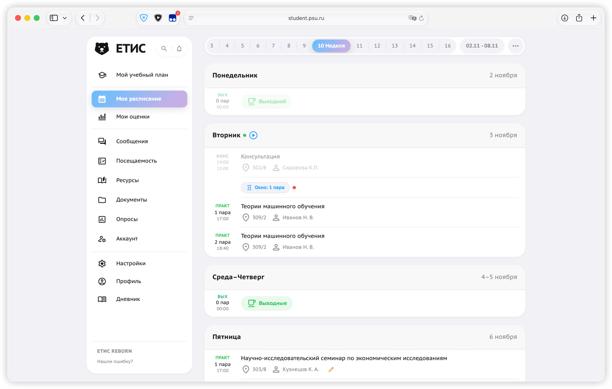
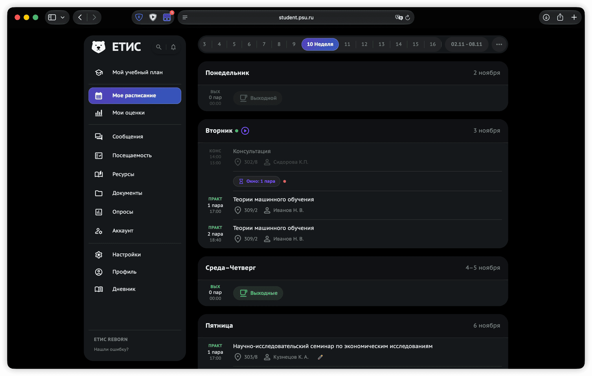
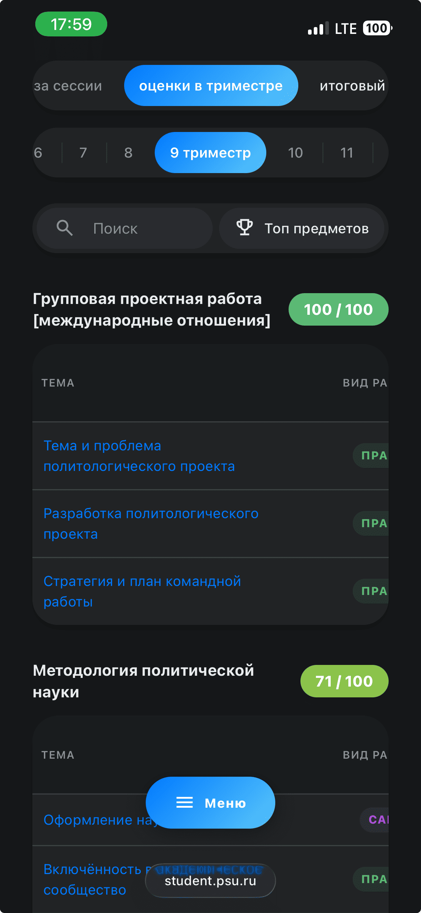

<div align="center">
  

  # ЕТИС REBORN
  **Сделай ЕТИС великим снова**

  [](https://raw.githubusercontent.com/defl-orator/etis-reborn/main/etis.user.js)
  [](https://etisreborn.ru/)
  [](LICENSE)

  *Userscript, полностью обновляющий личный кабинет студента ПГНИУ: современный дизайн, мобильная адаптация, расписание, дневник, аналитика и E2EE-синхронизация.*

  [**🌐 Сайт и установка**](https://etisreborn.ru/) • [**🐛 Сообщить об ошибке**](https://etisreborn.ru/#bugreport)

  <br>
  
</div>

---

## ✨ Возможности

- **Дизайн и темы:** светлая, тёмная и OLED (`night`) темы, автопереключение по системе или расписанию, акцентные цвета, градиенты и эффект стекла.
- **Умное расписание:** интеграция `.ics` календарей (iCloud / Google), импорт консультаций из DOCX, свои пары, затемнение прошедших занятий, светофор и недельная сводка.
- **Дневник и заметки:** дедлайны с привязкой к парам, напоминания, быстрые заметки и уведомления об изменении оценок.
- **Аналитика и разделы:** расчёт баллов до оценки/зачёта, графики GPA, настройка колонок, глобальный поиск (`Cmd/Ctrl + K`) и обновлённые страницы (библиотека, справки, приказы и др.).
- **Мобильная версия:** адаптивный интерфейс и свайп-жесты по парам и дням.
- **Синхронизация (E2EE):** сквозное шифрование заметок, дневника, пар и настроек между устройствами.

<div align="center">
  
  
</div>

---

## ⚙️ Установка

1. **ПК и Android (Chrome, Яндекс, Edge, Firefox):** установите [Tampermonkey](https://chromewebstore.google.com/detail/tampermonkey/dhdgffkkebhmkfjojejmpbldmpobfkfo) или [Violentmonkey](https://violentmonkey.github.io/) → перейдите по [ссылке установки](https://raw.githubusercontent.com/defl-orator/etis-reborn/main/etis.user.js) → нажмите **Установить**.
2. **Apple (Safari на iPhone, iPad, Mac):** установите [Stay for Safari](https://apps.apple.com/ru/app/stay-for-safari/id1591620171), включите расширение и добавьте скрипт по ссылке: `https://raw.githubusercontent.com/defl-orator/etis-reborn/main/etis.user.js`.

После установки откройте [student.psu.ru](https://student.psu.ru).

---

## 🛠 Разработка и сборка

Исходный код находится в [`vite/`](vite/):

```bash
cd vite
npm install
npm run build   # проверка типов + сборка в dist/etis.user.js
```

## 🔒 Приватность и обратная связь

Данные обрабатываются локально в браузере; облачная синхронизация (если включена) использует клиентское E2EE-шифрование.

- Баг-репорт: [etisreborn.ru/#bugreport](https://etisreborn.ru/#bugreport) или [GitHub Issues](https://github.com/defl-orator/etis-reborn/issues)

---

<div align="center">
  <i>Основано на идеях проекта <a href="https://vk.com/etis20">ETIS 2.0</a>. Создано с 💙 для студентов ПГНИУ.</i>
</div>
